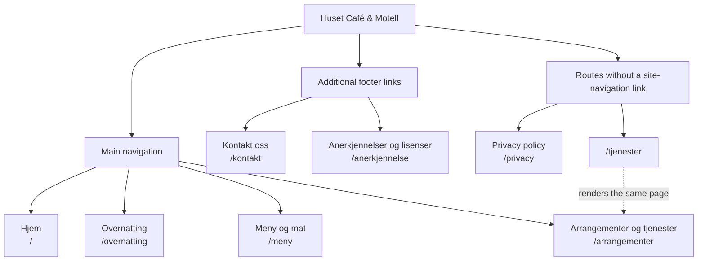

# Current site map

**Site:** [Huset Café & Motell](https://www.husetmotell.no/)  
**Recorded:** 20 October 2026  
**Scope:** Existing public pages, content sections, navigation, and outbound journeys. This is a current-state inventory, not a proposed redesign or an XML sitemap.

The site has **eight explicit routes serving seven distinct pages**. All routes are at the same URL level; sections within a page are not separate pages. Norwegian and English share the same URLs.

## Page map

Solid lines group pages by where visitors find them. The dotted line identifies an alternate route rendering the same page, not a redirect.

## Route inventory

| Route | Page | Current entry points |
|---|---|---|
| `/` | Hjem | Logo, main navigation, footer |
| `/overnatting` | Overnatting | Main navigation, footer, homepage room section |
| `/meny` | Restaurant / Meny og mat | Main navigation, footer, homepage food links |
| `/arrangementer` | Arrangementer og tjenester | Main navigation, footer, individual homepage event links |
| `/kontakt` | Kontakt oss | Footer, homepage contact buttons, accommodation contact buttons |
| `/anerkjennelse` | Anerkjennelser og lisenser | Footer attribution link |
| `/privacy` | Privacy policy | Direct URL; no internal navigation link found |
| `/tjenester` | Same page as `/arrangementer` | Direct URL; no internal navigation link found |

Unmatched paths render the homepage rather than a dedicated not-found page.

## Content within each page

These are content sections, not additional routes. Unless noted below, they do not have their own section-anchor destinations.

### Hjem — `/`

1. **Hero:** Logo, building and mountain imagery, welcome message, contact and mobile call actions.
2. **Opening hours and welcome:** Weekly hours, roadside location, introduction to the business.
3. **Location map:** Mobile map section; a desktop map also appears in the shared area above the footer.
4. **Rommene våre:** Room image, eight-room overview, breakfast, starting price, contact and accommodation links.
5. **Menyen vår:** Husmannskost, pizza, meat/burgers/kebabs, children's menu; links to `/meny`.
6. **Vi elsker å bake:** Cake promotion, cake-menu link, cake-ordering link.
7. **Arrangementer ved Huset Café & Motell:** Concerts/pub/nightclub, sushi evenings, private events.
8. **Vi tilbyr catering:** Catering promotion and information link.

### Overnatting — `/overnatting`

1. **Hero and booking:** Breakfast message, contact/call actions, external Booking.com link.
2. **Rommene våre:** Beds and rooms, bathrooms, comfort.
3. **Dobbeltrom:** Description, starting price, breakfast included.
4. **Enkeltrom:** Description, starting price, breakfast included.
5. **Frokost:** Self-service breakfast and dedicated breakfast room.
6. **Practical information:** Café/restaurant, payment, check-in and check-out.
7. **Området rundt:** Korgensenteret, Circle K Korgen, Hemnes municipality, Okstindan.

### Restaurant / Meny og mat — `/meny`

1. **Hero:** Restaurant introduction, home-style food and pizza.
2. **Vår meny:** Pizza, Fra Grillen, Fiskeretter, Småretter, Husets Retter, Barnemeny.
3. **Menu-item content:** Name, price, description where supplied, allergen list.

The implementation starts with bundled menu data and requests updates from `https://admin.husetmotell.no/api/v1/menus`. That request timed out during the live inspection, so the categories above describe the fallback menu that was displayed.

### Arrangementer og tjenester — `/arrangementer` and `/tjenester`

1. **Hero:** Events and services introduction.
2. **Arrangementer:** Concerts, pub/nightclub, Sunday dinner.
3. **Spesielle arrangementer:** Sushi evenings, steak evenings, game dinners; image galleries.
4. **Tjenester:** Meeting rooms and venue hire for private functions.

Concert and pub sections send visitors to Facebook for upcoming events. There is no separate event-detail route or dated event-calendar page.

### Kontakt oss — `/kontakt`

1. **Introduction:** Invitation to enquire about rooms, meals, functions, or other questions.
2. **Direct contact:** Phone and email.
3. **Enquiry form:** Name, email, telephone, message.
4. **Confirmation:** In-page thank-you state, not a separate confirmation URL.

### Supporting pages

| Page | Content |
|---|---|
| `/anerkjennelse` | Credits and licence links for the background pattern and Okstinden image |
| `/privacy` | English privacy-policy text |

## Shared navigation and outbound journeys

| Surface / action | Current destinations |
|---|---|
| Main navigation | Hjem, Overnatting, Meny og mat, Arrangementer |
| Language selector | Norsk / Engelsk; changes language in place, without a language-specific route |
| Footer navigation | The four main-navigation pages, plus Kontakt oss |
| Footer supporting links | Credits, Facebook, Visit Okstindan, Visit Helgeland, Simsø Web |
| Shared area above footer | Google Maps and Facebook feed |
| Book a room | [Booking.com](https://www.booking.com/hotel/no/huset-cafe-amp-motell-as.en-gb.html); no on-site booking flow. *Since retired: the motel no longer uses Booking.com, and the new site books by phone or message.* |
| Call | `tel:+4740317353` |
| Email | `mailto:kontakt@husetmotell.no` |
| Send an enquiry | Netlify Forms submission from `/kontakt`; no on-site account or inbox |
| Follow current events | [Huset on Facebook](https://www.facebook.com/Husetcafe) |
| Explore the area | [Visit Okstindan](https://visitokstindan.com/), [Visit Helgeland](https://visithelgeland.com/), [Hemnes municipality](https://www.hemnes.kommune.no/), Korgensenteret and Circle K Facebook links |
| Homepage location reference | [Hemnes on Wikipedia](https://no.wikipedia.org/wiki/Hemnes) |
| Credits and policy references | Hero Patterns, Wikimedia Commons, Creative Commons, FreePrivacyPolicy |

## Existing links without matching destinations

The following homepage links reach `/meny`, but the requested section IDs do not exist. They are not separate pages or implemented ordering flows.

| Homepage link | Current target | Current-state issue |
|---|---|---|
| Se kakemenyen vår | `/meny#kaker` | No matching cake section |
| Bestill en kake? | `/meny#kake-bestilling` | No matching cake-order section or dedicated ordering form |
| Les mer om cateringmulighetene | `/meny#catering` | No matching catering section |
| Se alle arrangementer og tjenester | `/meny#kaker` | Points to the menu's missing cake section, not the events/services page |

## On the new site

The replacement in `website/` (see [its README](website/README.md)) keeps every route above working:

| Old route | New site |
|---|---|
| `/` | Homepage, now holding the room, gathering and meeting-room content as sections, with links on to the events and catering pages |
| `/overnatting` | Forwards to `/#rom` |
| `/arrangementer` | Events page: concerts and pub nights, theme evenings (`#temakvelder`), private parties (`#selskap`) |
| `/tjenester` | Forwards to `/#selskap` |
| — | `/catering` is new: the catering offer and how to order |
| `/meny` | The menu page. Section anchors are `#grill`, `#pizza`, `#fisk`, `#smaretter`, `#salat`, `#pita`, `#omelett`, `#barn`, `#ekstra` and `#drikke`; the old `#kaker`, `#kake-bestilling` and `#catering` links land at the top of the page. |
| `/kontakt` | Contact page with the same Netlify form; `/kontakt/takk` is new |
| `/anerkjennelse`, `/privacy` | Same paths; in English at `/en/credits` and `/en/privacy` |

The old site switched language in place on the same URLs. The new site gives English its own pages under `/en`: `/en` (homepage), `/en/menu`, `/en/events`, `/en/catering`, `/en/contact` (with `/en/contact/thanks`), `/en/credits` and `/en/privacy`. Every page is in both languages; a page added later in Norwegian only stays Norwegian, and links to it say so.

Unknown paths get a real 404 page instead of the homepage.

The area links (Visit Okstindan, Visit Helgeland and Hemnes kommune) sit under «Mer om området» in the homepage's «Rundt Huset» section, with the English versions of the sites on `/en`.

## Sources

- Live homepage and the accommodation, menu, events, and contact pages, inspected on 20 October 2026.
- Route definitions: `src/App.tsx`.
- Shared navigation: `src/components/navigation/index.tsx`, `src/components/footer/index.tsx`.
- Page content and links: `src/pages/`, `public/locales/`, `src/data/menu.json`.

Supporting routes and unmatched-path behavior are documented from the source code. External destinations are recorded as links, not independently verified services.
